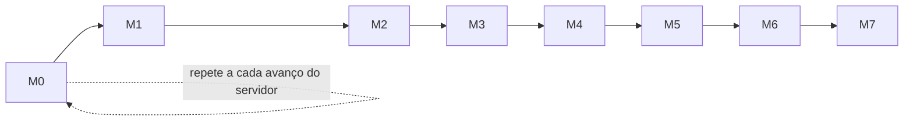

# Marcos de desenvolvimento — Zeny Hotel Manager (front-end desktop)

> Criado em 2026-11-10 · fonte: [design](../superpowers/specs/2026-11-10-front-desktop-design.md) §7 e [ADR 0006](../adr/0006-marcos-por-valor-de-demo.md)

O front desktop está dividido em **oito marcos**. Cada um termina numa **build testável conectada ao servidor**: um JAR do app, o `demo-seed` e um roteiro de demo que o usuário executa clicando no gate (`Revisão humana: sim`). A ordem segue o **valor para a demo de 17/11/2026**, não as camadas do servidor. A configuração que a operação exige é criada pela API pelo `demo-seed`.

O servidor de referência é o commit fixado em `api/server-pin.properties` ([ADR 0002](../adr/0002-servidor-fixado-e-contrato-copiado.md)), rodando no ambiente isolado `zeny-front` ([ADR 0003](../adr/0003-ambiente-do-servidor-isolado.md)).

## Mapa dos marcos

| Marco | Roadmap | Etapas | Entrega (build testável) | Depende de |
|---|---|---|---|---|
| M0 | [Sincronização com o servidor](roadmap-m0-sincronizacao.md) | 1 por rodada | Commit fixado, contrato copiado, pré-voo de defasagem, ambiente do servidor e pacote do Windows. Repete-se a cada avanço do servidor | — |
| M1 | [Fundação e mapa de UHs](roadmap-m1-fundacao.md) | 7 | Projeto Gradle, SDK gerado, núcleo HTTP e sessão, design system, login com endereço do servidor, menu por permissão, aprovação de superior, tempo real, `demo-seed` e mapa de UHs ao vivo | M0 E01 |
| M2 | [Recepção do dia](roadmap-m2-recepcao-do-dia.md) | 7 | Painel do dia, check-in com alocação, ficha de registro em PDF (visualizador e impressão local), walk-in, troca de UH, desfazer check-in e recados | M1 e M0 E02 |
| M3 | [Reservas](roadmap-m3-reservas.md) | 6 | Busca, disponibilidade e cotação, nova reserva e alteração com a confirmação em PDF, cancelar e reativar, pendências. Depois do gate, a revisão adiada do processo acelerado (E06) | M2 e M0 E03 |
| M4 | [Contas, caixa e check-out](roadmap-m4-contas-caixa-checkout.md) | 5 | Conta da hospedagem com extrato em PDF, turno de caixa, pagamentos e cauções, check-out | M3, com a E06 |
| M5 | [Hóspedes e empresas](roadmap-m5-hospedes-empresas.md) | 5 | Perfil completo (com a descrição do gênero da FNRH), documentos com trilha, duplicados e mesclagem, LGPD, empresas | M4 |
| M6 | [Governança e operação](roadmap-m6-governanca-operacao.md) | 8 | Status de governança, OOO/OOS, checklists, notificações, escala do dia e fechamento do dia (desbloqueado pela rodada 3 do M0) | M5 |
| M7 | [Gestão e cadastros](roadmap-m7-gestao-cadastros.md) | 12 | UHs, tarifas, bloqueios, usuários e roles, hotel, financeiro, modelos de checklist, pessoal, FNRH com a fila de envio, auditoria, impressoras e agentes de impressão | M6 |

O gate de cada marco é um dia de trabalho (o usuário faz um gate por dia). Se 17/11 chegar no meio de um marco, a demo usa a build do último gate concluído. O M6 e o M7 provavelmente ficam para depois da demo (design §7.1).

## Regras para todos os marcos

1. **Um marco por vez.** O marco N só começa quando o gate do marco N−1 está `#concluida`.
2. **Pré-voo em toda execução.** Antes de escolher a etapa, o orquestrador roda `tools/server-drift.sh` (criado na M0 E01) e trata o resultado:
   - **igual:** segue;
   - **avançou só com acréscimos:** registra no relatório e segue;
   - **breaking change em operação usada pelo front:** para e recomenda o M0.

   Não se troca o servidor fixado no meio de um marco.
3. **Sincronize antes de começar um marco.** Se a `main` do servidor avançou, a rodada do M0 vem antes da primeira etapa do marco seguinte. Ela tem duas partes:
   - a análise, feita por `claude --agent arquiteto` com `development-roadmap` em modo atualização, que acrescenta etapas e atualiza `docs/pedidos-servidor.md`;
   - a etapa mecânica, executada pelo orquestrador.
4. **O repositório do servidor é só leitura.** Nenhuma sessão do front escreve em `/home/caio/repos/ZenyHotelManager`, nem com worktree, checkout ou arquivo novo. O que faltar na API vira pedido `PF-NN` pelo brain ([ADR 0005](../adr/0005-pedidos-ao-servidor-pelo-brain.md)). Até 17/11, nenhuma etapa depende de pedido.
5. **Recriar a demo.** O roteiro de cada gate começa pela recriação: `down -v`, `up -d` e `demo-seed`. Num banco novo, a data operacional é o dia da recriação. Desde o servidor em `5e06f16d51ff` (M0 E03), ela avança sozinha: o servidor fecha o dia às 03:00 do dia seguinte, o horário padrão do fechamento (`endOfDayTime`). Nesse fechamento:
   - as chegadas confirmadas sem check-in viram no-show, com multa;
   - as diárias são lançadas;
   - a data passa ao dia seguinte.

   Por isso, a recriação vale só para o dia em que é feita. Recrie no mesmo dia do roteiro ou da demo, depois das 03:00, e nunca deixe um ambiente recriado na véspera para usar no dia seguinte. O seed não muda o horário do fechamento. Esse horário é a última hora possível antes da demo; um horário depois do meio-dia fecharia no mesmo dia. O fechamento manual só entra num roteiro a partir do M6 (E08), por último ou seguido de nova recriação.
6. **Push e deploy ficam com o usuário.** A execução commita na branch `roadmap/<slug>` e, no fim do lote, faz merge local na `main`.
7. **Validação no Windows acumulada (temporária).** O usuário decidiu em 2026-11-13 que, enquanto estiver sem acesso ao Windows (até domingo, 2026-11-15, pelo menos), o lote não para por isso. Em 2026-11-15 ele estendeu a regra: a validação no Windows fica para o fim do M3, no gate dele (M3 E05), que executa a lista acumulada de uma vez. A regra vale até ele mesmo tirá-la deste README. Enquanto ela valer:
   - Uma etapa com `Revisão humana: sim` cuja **única** pendência é o usuário executar algo no Windows não para o lote. Isso cobre roteiro de gate, pacote e readiness lá. O orquestrador:
     - verifica no notebook tudo o que dá;
     - gera o pacote;
     - deixa a etapa `#em-andamento`, com "Aguardando o Windows" no estado do handoff;
     - acrescenta a etapa à lista "Validações acumuladas no Windows" abaixo;
     - segue para a próxima etapa.
   - Para a escolha da próxima etapa e para a regra 1, essa etapa conta como concluída. Quem depende dela registra no próprio handoff que a base ainda não foi validada no Windows.
   - O orquestrador não retoma essa etapa só para esperar o usuário.
   - Revisão humana que não é no Windows continua parando o lote. Isso inclui entrevista de arquitetura e decisão de produto.
   - Quando o usuário voltar ao Windows, ele executa a lista na ordem, com o pacote mais recente:
     - cada aprovação fecha a etapa `#concluida`;
     - uma reprovação reabre a etapa com uma rodada de correção, antes de qualquer etapa nova.
8. **Processo acelerado (revogado).** Valeu de 2026-11-16 a 2026-11-17, pelo [ADR 0011](../adr/0011-processo-acelerado-ate-a-demo.md), e foi revogado pelo [ADR 0012](../adr/0012-revoga-o-processo-acelerado.md): o ciclo padrão das souls passou a trazer o que ele buscava. Desde a revogação:
   - nenhuma etapa nova entra por esta regra, e os roadmaps não têm mais o "Prompt acelerado";
   - toda execução segue o ciclo completo do orquestrador, com a `revisor-seguranca` em cada tarefa e na revisão final e com o scanner;
   - a etapa só fecha `#concluida` com a revisão final limpa e a evidência de cada critério de aceite;
   - as etapas que fecharam por esta regra mantêm no handoff a linha `Revisão de segurança: adiada (ADR 0011)` e a entrada na lista "Revisões de segurança adiadas" abaixo. Essa lista é o escopo da dívida de revisão;
   - **a dívida é paga antes do M4**, na M3 E06 (decisão do usuário em 2026-11-17, por entrevista; ADR 0012). O M4 só começa com a M3 E06 `#concluida`.

## Revisões de segurança adiadas

Etapas executadas pela regra 8 sem a `revisor-seguranca`, na ordem em que fecharam. Cada entrada traz:
- a etapa;
- o intervalo de commits na branch do roadmap, `<MERGE_BASE da etapa>..<HEAD no fechamento>`. Os SHAs se preservam no merge na `main`;
- a saída da `check_test_integrity.py --base <MERGE_BASE>` (exit e apontamentos);
- os achados estacionados no ledger.

A M3 E06 paga a lista inteira, antes do M4 (ADR 0012). A revisão cobre `a300a23..HEAD`, com o scanner e a `check_test_integrity.py --base a300a23`. Os achados Críticos e Importantes são corrigidos nela.

1. **M3 E02 — Disponibilidade e cotação.**
   - Commits: `b6aafa9..2ad4b09` na `roadmap/m3-reservas`.
   - Integridade (`--base b6aafa9`): exit 1. `MERGE_IGNORADO` no merge da `main` (`141b5ba`, só documentos) e 3 `DEV_TESTE_DO_TESTADOR` (`cd502bd`, `4b84767`, `1e65a58`), já julgados justificados na revisão por tarefa.
   - Já revisado por tarefa (`revisor-seguranca`): Tasks 1–8, `70c49e9..d26f9dd`. Sem revisão: a Task 9 (`141b5ba..006c8d8`), o testador de etapa (`006c8d8..2ad4b09`) e a revisão final do intervalo.
   - Achados estacionados: as dívidas menores das "Notas para a próxima etapa" da E02, no roadmap do M3.
2. **M3 E03 — Nova reserva e alteração.**
   - Commits: `5cbac31..87f03cb` na `roadmap/m3-reservas`.
   - Integridade (`--base 5cbac31`): exit 1. Um `SKIP_ADICIONADO` em `tests/test_live_booking_ataque.sh` (`87f03cb`), falso positivo: a linha `nao_tem '@Disabled'` é a trava que proíbe desligar a verificação ao vivo.
   - Nenhuma tarefa teve revisão de código. O testador de etapa atacou o intervalo inteiro, sem defeito.
   - Achados estacionados: as observações do testador e as dívidas das "Notas para a próxima etapa" da E03, no roadmap do M3.
3. **M3 E04 — Cancelar, reativar e pendências.**
   - Commits: `fc7a0b3..72e4316` na `roadmap/m3-reservas`.
   - Integridade (`--base fc7a0b3`): exit 1. Dois `SKIP_ADICIONADO` em `tests/test_live_lifecycle_ataque.sh`, falsos positivos: as linhas `nao_tem '@Disabled'` e `nao_tem '@Ignore'` são a trava que proíbe desligar a verificação ao vivo.
   - Nenhuma tarefa teve revisão de código. O testador de etapa atacou o intervalo inteiro, sem defeito.
   - Achados estacionados: as observações do testador e as dívidas das "Notas para a próxima etapa" da E04, no roadmap do M3.
4. **M3 E05 — Gate do marco M3 (só o trecho feito antes da revogação; a etapa segue `#em-andamento`).**
   - Commits: `830f296..920dcd2` na `roadmap/m3-reservas`.
   - Integridade (`--base 830f296 --head 920dcd2`): exit 0, nenhum apontamento.
   - Só a Task 1 tem código (`e8a1542..920dcd2`: o `FutureSeeder` e a porta `FutureGateway`, no `demo-seed`), e ela não teve revisão de código nem testador. Os outros dois commits do intervalo são documentos do orquestrador (a tag e o plano). O restante da etapa segue o processo normal (ADR 0012).
   - Achados estacionados: nenhum no ledger da etapa.

## Validações acumuladas no Windows

Pendentes da regra 7, na ordem em que entraram. Por decisão do usuário (2026-11-15), são executadas juntas no fim do M3, no gate dele, com o roteiro do M3 (que acumula o do M2 e o do M1) e o pacote mais recente:

1. **M0 E02** (servidor em `57eb5fac5b8a`): executar o `roteiro-m3.md` do pacote mais recente, do zero; ele acumula o do M2 e o do M1 (decisão da M3 E05). Para não construir a imagem no Windows, fazer antes o `docker load` de `images/zeny-server-images.tar`. A aprovação fecha a etapa `#concluida`.
2. **M2 E06** (gate do M2): a mesma execução do `roteiro-m3.md` da entrada 1. A aprovação fecha também esta etapa `#concluida`; uma reprovação a reabre com uma rodada de correção.
3. **M0 E03** (servidor em `5e06f16d51ff`): a mesma execução do `roteiro-m3.md` da entrada 1, com o pacote desta etapa ou um mais recente. A aprovação fecha também esta etapa `#concluida`; uma reprovação a reabre com uma rodada de correção.
4. **M3 E05** (gate do M3): a mesma execução do `roteiro-m3.md` da entrada 1, com o pacote de `build/demo-package/` gerado em 2026-11-17 (`VERSAO.txt`: `front_commit=a800b25`, com as correções da M3 E06, que ainda esperam a revisão final) ou um mais recente. Este é o gate em que o usuário decidiu executar a lista inteira (decisão de 2026-11-15). As notas para a execução estão no handoff da M3 E05. A aprovação fecha também esta etapa `#concluida`; uma reprovação a reabre com uma rodada de correção.

## Pendências do usuário antes da primeira execução

Estão no design, §10:

1. Commitar estes documentos na `main`, porque o repositório ainda não tem commit e o orquestrador cria o worktree a partir do `HEAD`.
2. Registrar o projeto no brain como `ZenyHotelManager-DesktopFront`.
3. Trocar o casamento do `load-brain.py` para casar pelo prefixo.
4. Acrescentar ao servidor a regra dos pedidos `PF-NN`.
5. Instalar o JDK 25 no Windows e liberar a porta 8088 no firewall de lá.

## Histórico de revisões

- 2026-11-10 — marcos definidos e roadmaps criados (`claude --agent arquiteto`).
- 2026-11-13 — análise da rodada 2 do M0 (`claude --agent arquiteto`), contra o servidor em `57eb5fac5b8a`. Entraram a M0 E02 (sincronização), a M2 E07 (ficha de registro), a M6 E08 (fechamento do dia, `#bloqueada`) e a M7 E12 (impressão), e cresceram a M3 E03, a M4 E02, a M5 E01 e a M7 E10. Decisões no [ADR 0009](../adr/0009-documentos-pdf-e-impressao.md). O M2 passa a exigir a M0 E02 concluída.
- 2026-11-13 — regra 7 e a lista "Validações acumuladas no Windows", por decisão do usuário: sem acesso ao Windows até 2026-11-15 pelo menos, a validação lá é acumulada e não para o lote. A M0 E02 é a primeira da lista (`claude --agent orquestrador`).
- 2026-11-15 — a M2 E06 (gate do M2) entra na lista "Validações acumuladas no Windows", e a entrada 1 passa a pedir o `roteiro-m2.md`, que acumula o do M1 (`claude --agent orquestrador`).
- 2026-11-15 — por decisão do usuário, a validação no Windows (regra 7) fica para o fim do M3: a lista acumulada é executada no gate do M3, e o M3 começa sem esperar o Windows (`claude --agent orquestrador`).
- 2026-11-15 — análise da rodada 3 do M0 (`claude --agent arquiteto`), contra o servidor em `5e06f16d51ff`. Entra a M0 E03 (sincronização), que vem antes da M3 E01 (regra 3). A M6 E08 sai de `#bloqueada`, porque as etapas do fechamento (M6 E11 do servidor) chegaram. A regra 5 foi revista para o fechamento automático das 03:00. O tratamento do primeiro `oneOf` do contrato ficou no [ADR 0010](../adr/0010-resposta-que-varia-com-a-permissao.md), decidido pelo usuário em entrevista. Notas novas na M3 E04, na M3 E05, na M5 E02 e na M7 E10.
- 2026-11-16 — a M0 E03 entra na lista "Validações acumuladas no Windows" (item 3), aguardando o Windows pela regra 7; o M3 pode começar (`claude --agent orquestrador`).
- 2026-11-16 — regra 8 (processo acelerado) e a lista "Revisões de segurança adiadas", por decisão do usuário ([ADR 0011](../adr/0011-processo-acelerado-ate-a-demo.md)). Cada roadmap ganhou um "Prompt acelerado" logo abaixo do "Prompt de execução" (`claude --agent arquiteto`).
- 2026-11-16 — a M3 E02 entra na lista "Revisões de segurança adiadas" (`claude --agent orquestrador`).
- 2026-11-16 — a M3 E03 entra na lista "Revisões de segurança adiadas" (`claude --agent orquestrador`).
- 2026-11-17 — a M3 E04 entra na lista "Revisões de segurança adiadas" (`claude --agent orquestrador`).
- 2026-11-17 — regra 8 encerrada: o processo acelerado foi revogado pelo [ADR 0012](../adr/0012-revoga-o-processo-acelerado.md), por decisão do usuário, depois da mudança das souls. Os roadmaps perderam o "Prompt acelerado". A M3 E05, iniciada no processo acelerado, segue o processo normal, e o trecho já commitado dela entrou na lista "Revisões de segurança adiadas" (item 4). Por entrevista, o usuário decidiu pagar a dívida antes do M4: entra a M3 E06, e o M4 passa a exigi-la. Notas de partes independentes, para as ondas dos planos, em etapas pendentes do M4 ao M7 (`claude --agent arquiteto`).
- 2026-11-17 — a M3 E05 entra na lista "Validações acumuladas no Windows" (item 4), aguardando o Windows pela regra 7, e as entradas 1 a 3 passam a pedir o `roteiro-m3.md` (`claude --agent orquestrador`).
- 2026-11-17 — o pacote da entrada 4 de "Validações acumuladas no Windows" passa a ser o de `a800b25`, gerado na M3 E06 com as correções da revisão adiada. A E06 segue `#em-andamento` (falta a revisão final), e a lista "Revisões de segurança adiadas" ainda não tem a marca de paga (`claude --agent orquestrador`).
