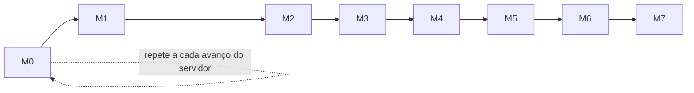

# Marcos de desenvolvimento — Zeny Hotel Manager (front-end desktop)

> Criado em 2026-11-10 · fonte: [design](../superpowers/specs/2026-11-10-front-desktop-design.md) §7 e [ADR 0006](../adr/0006-marcos-por-valor-de-demo.md)

O front desktop está dividido em **oito marcos**. Cada um termina numa **build testável conectada ao servidor**: um JAR do app, o `demo-seed` e um roteiro de demo que o usuário executa clicando no gate (`Revisão humana: sim`). A ordem segue o **valor para a demo de 17/11/2026**, não as camadas do servidor. A configuração que a operação exige é criada pela API pelo `demo-seed`.

O servidor de referência é o commit fixado em `api/server-pin.properties` ([ADR 0002](../adr/0002-servidor-fixado-e-contrato-copiado.md)), rodando no ambiente isolado `zeny-front` ([ADR 0003](../adr/0003-ambiente-do-servidor-isolado.md)).

## Mapa dos marcos

| Marco | Roadmap | Etapas | Entrega (build testável) | Depende de |
|---|---|---|---|---|
| M0 | [Sincronização com o servidor](roadmap-m0-sincronizacao.md) | 1 por rodada | Commit fixado, contrato copiado, pré-voo de defasagem, ambiente do servidor e pacote do Windows. Repete-se a cada avanço do servidor | — |
| M1 | [Fundação e mapa de UHs](roadmap-m1-fundacao.md) | 7 | Projeto Gradle, SDK gerado, núcleo HTTP e sessão, design system, login com endereço do servidor, menu por permissão, aprovação de superior, tempo real, `demo-seed` e mapa de UHs ao vivo | M0 E01 |
| M2 | [Recepção do dia](roadmap-m2-recepcao-do-dia.md) | 7 | Painel do dia, check-in com alocação, ficha de registro em PDF (visualizador e impressão local), walk-in, troca de UH, desfazer check-in e recados | M1 e M0 E02 |
| M3 | [Reservas](roadmap-m3-reservas.md) | 5 | Busca, disponibilidade e cotação, nova reserva e alteração com a confirmação em PDF, cancelar e reativar, pendências | M2 |
| M4 | [Contas, caixa e check-out](roadmap-m4-contas-caixa-checkout.md) | 5 | Conta da hospedagem com extrato em PDF, turno de caixa, pagamentos e cauções, check-out | M3 |
| M5 | [Hóspedes e empresas](roadmap-m5-hospedes-empresas.md) | 5 | Perfil completo (com a descrição do gênero da FNRH), documentos com trilha, duplicados e mesclagem, LGPD, empresas | M4 |
| M6 | [Governança e operação](roadmap-m6-governanca-operacao.md) | 8 | Status de governança, OOO/OOS, checklists, notificações, escala do dia e fechamento do dia (bloqueado até o servidor ter as etapas do fechamento) | M5 |
| M7 | [Gestão e cadastros](roadmap-m7-gestao-cadastros.md) | 12 | UHs, tarifas, bloqueios, usuários e roles, hotel, financeiro, modelos de checklist, pessoal, FNRH com a fila de envio, auditoria, impressoras e agentes de impressão | M6 |

O gate de cada marco é um dia de trabalho (o usuário faz um gate por dia). Se 17/11 chegar no meio de um marco, a demo usa a build do último gate concluído. O M6 e o M7 provavelmente ficam para depois da demo (design §7.1).

## Regras para todos os marcos

1. **Um marco por vez.** O marco N só começa quando o gate do marco N−1 está `#concluida`.
2. **Pré-voo em toda execução.** Antes de escolher a etapa, o orquestrador roda `tools/server-drift.sh` (criado na M0 E01) e trata o resultado:
   - **igual:** segue;
   - **avançou só com acréscimos:** registra no relatório e segue;
   - **breaking change em operação usada pelo front:** para e recomenda o M0.

   Não se troca o servidor fixado no meio de um marco.
3. **Sincronize antes de começar um marco.** Se a `main` do servidor avançou, a rodada do M0 vem antes da primeira etapa do marco seguinte. Ela tem duas partes:
   - a análise, feita por `claude --agent arquiteto` com `development-roadmap` em modo atualização, que acrescenta etapas e atualiza `docs/pedidos-servidor.md`;
   - a etapa mecânica, executada pelo orquestrador.
4. **O repositório do servidor é só leitura.** Nenhuma sessão do front escreve em `/home/caio/repos/ZenyHotelManager`, nem com worktree, checkout ou arquivo novo. O que faltar na API vira pedido `PF-NN` pelo brain ([ADR 0005](../adr/0005-pedidos-ao-servidor-pelo-brain.md)). Até 17/11, nenhuma etapa depende de pedido.
5. **Recriar a demo.** O roteiro de cada gate começa pela recriação: `down -v`, `up -d` e `demo-seed`. A data operacional só avança no M6 do servidor, então "hoje" é o dia da recriação.
6. **Push e deploy ficam com o usuário.** A execução commita na branch `roadmap/<slug>` e, no fim do lote, faz merge local na `main`.
7. **Validação no Windows acumulada (temporária).** O usuário decidiu em 2026-11-13 que, enquanto estiver sem acesso ao Windows (até domingo, 2026-11-15, pelo menos), o lote não para por isso. A regra vale até ele mesmo tirá-la deste README. Enquanto ela valer:
   - Uma etapa com `Revisão humana: sim` cuja **única** pendência é o usuário executar algo no Windows não para o lote. Isso cobre roteiro de gate, pacote e readiness lá. O orquestrador:
     - verifica no notebook tudo o que dá;
     - gera o pacote;
     - deixa a etapa `#em-andamento`, com "Aguardando o Windows" no estado do handoff;
     - acrescenta a etapa à lista "Validações acumuladas no Windows" abaixo;
     - segue para a próxima etapa.
   - Para a escolha da próxima etapa e para a regra 1, essa etapa conta como concluída. Quem depende dela registra no próprio handoff que a base ainda não foi validada no Windows.
   - O orquestrador não retoma essa etapa só para esperar o usuário.
   - Revisão humana que não é no Windows continua parando o lote. Isso inclui entrevista de arquitetura e decisão de produto.
   - Quando o usuário voltar ao Windows, ele executa a lista na ordem, com o pacote mais recente:
     - cada aprovação fecha a etapa `#concluida`;
     - uma reprovação reabre a etapa com uma rodada de correção, antes de qualquer etapa nova.

## Validações acumuladas no Windows

Pendentes da regra 7, na ordem em que entraram:

1. **M0 E02** (servidor em `57eb5fac5b8a`): executar o `roteiro-m1.md` do pacote do zero. Para não construir a imagem no Windows, fazer antes o `docker load` de `images/zeny-server-images.tar`. A aprovação fecha a etapa `#concluida`.

## Pendências do usuário antes da primeira execução

Estão no design, §10:

1. Commitar estes documentos na `main`, porque o repositório ainda não tem commit e o orquestrador cria o worktree a partir do `HEAD`.
2. Registrar o projeto no brain como `ZenyHotelManager-DesktopFront`.
3. Trocar o casamento do `load-brain.py` para casar pelo prefixo.
4. Acrescentar ao servidor a regra dos pedidos `PF-NN`.
5. Instalar o JDK 25 no Windows e liberar a porta 8088 no firewall de lá.

## Histórico de revisões

- 2026-11-10 — marcos definidos e roadmaps criados (`claude --agent arquiteto`).
- 2026-11-13 — análise da rodada 2 do M0 (`claude --agent arquiteto`), contra o servidor em `57eb5fac5b8a`. Entraram a M0 E02 (sincronização), a M2 E07 (ficha de registro), a M6 E08 (fechamento do dia, `#bloqueada`) e a M7 E12 (impressão), e cresceram a M3 E03, a M4 E02, a M5 E01 e a M7 E10. Decisões no [ADR 0009](../adr/0009-documentos-pdf-e-impressao.md). O M2 passa a exigir a M0 E02 concluída.
- 2026-11-13 — regra 7 e a lista "Validações acumuladas no Windows", por decisão do usuário: sem acesso ao Windows até 2026-11-15 pelo menos, a validação lá é acumulada e não para o lote. A M0 E02 é a primeira da lista (`claude --agent orquestrador`).
