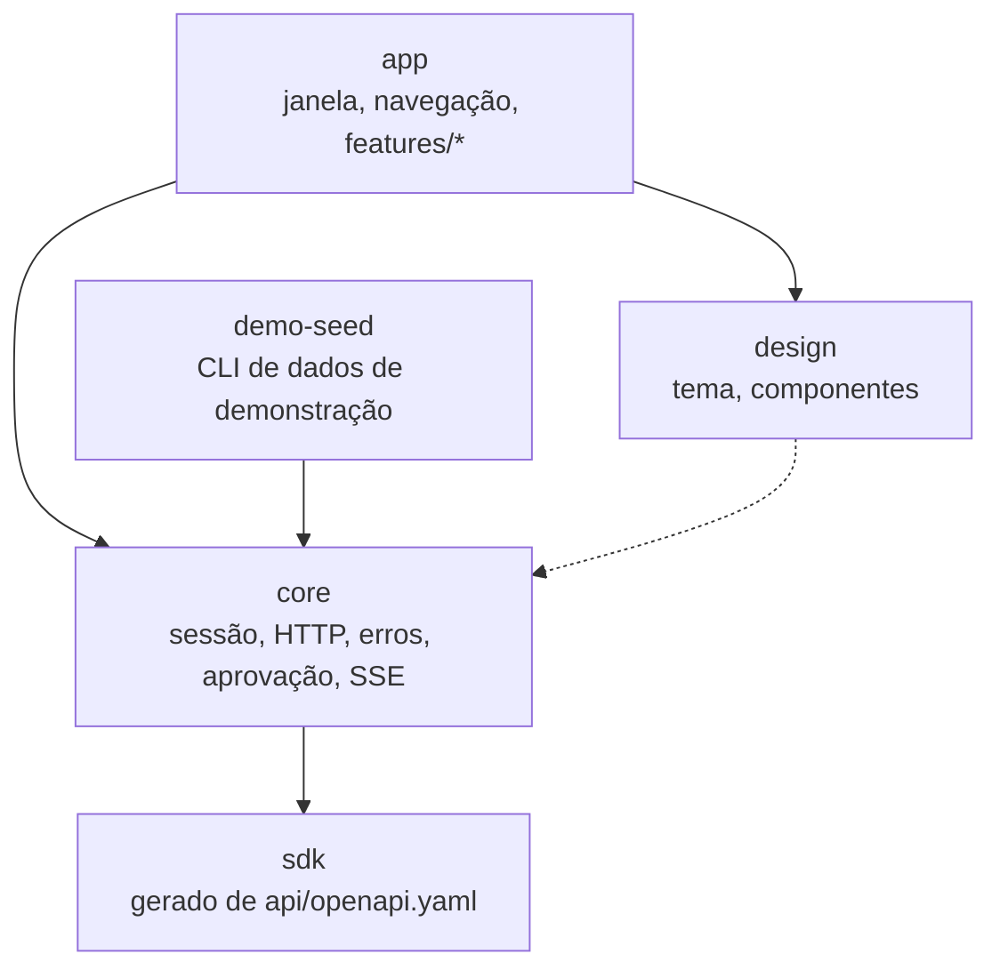
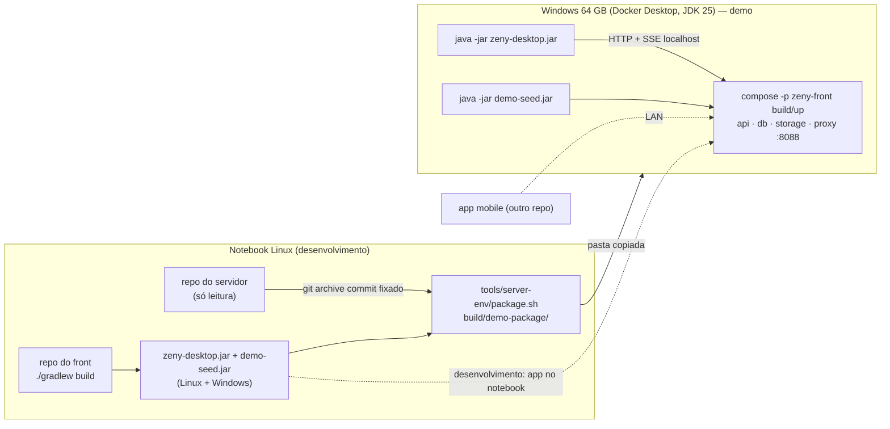
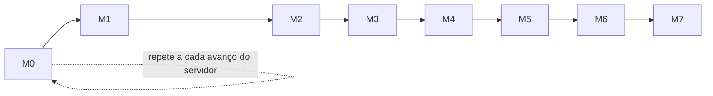
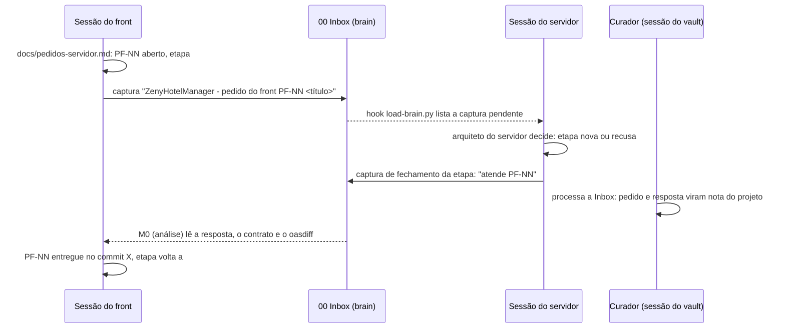

# Design — Front-end desktop do Zeny Hotel Manager

> 2026-11-10 · sessão `claude --agent arquiteto` · repositório `ZenyHotelManager-DesktopFront` (vazio, sem commits, no início da sessão)
>
> Servidor de referência: `/home/caio/repos/ZenyHotelManager`, `main` em `ca9f9e2f9808c74c98154f1e8e60381fecbf1b5d` (M5 até a E07). Fontes do servidor citadas: `docs/SPEC.md`, `docs/ARCHITECTURE.md`, `docs/roadmaps/README.md`, `api/openapi.yaml`, `docker/compose.yaml`, `docker/.env.example`; no Second Brain, o hub `10 Projects/ZenyHotelManager.md` e as notas `ZenyHotelManager - *` de `20 Knowledge/`.

## 1. Intenção e porquê

O servidor do Zeny Hotel Manager (PMS de um único hotel com até 30 UHs) já expõe 303 operações REST, mas ainda não tem nenhum cliente. O usuário quer começar o **cliente desktop** (recepção, gerência e, para a demo, também governança), desenvolvido **em paralelo** ao servidor por outro orquestrador.

O primeiro marco de negócio é uma **demo em 17/11/2026** (terça, sete dias depois desta sessão) para o gerente, que **não é de TI**. Ele precisa ver **o máximo possível da aplicação rodando**, com aparência e experiência de produto. Amplitude vale mais que profundidade.

Na demo, **servidor e app desktop rodam juntos na máquina Windows** de 64 GB, que terá o JDK 25 instalado (usuário). No mesmo dia o usuário talvez mostre também um app mobile, que vai ter repositório próprio e **apontar para o mesmo servidor da demo**. Esse servidor é do front desktop: só o tooling do desktop sobe, popula e recria o ambiente, e o mobile não roda seed nem `down -v` nele (chamada do arquiteto).

Depois da demo, o front acompanha o servidor conforme ele avança.

## 2. Objetivos, não objetivos e anti-objetivos

**Objetivos**

- App desktop que consome o servidor real pelo contrato `api/openapi.yaml`, dividido em marcos que **terminam numa build testável conectada ao servidor**.
- Cobrir até 17/11 tudo ou quase tudo que o servidor já entrega, **na ordem de valor para a demo** (§7), de modo que qualquer ponto de corte renda uma demo coerente.
- O desktop é o **superconjunto** do mobile: tudo que o mobile faz o desktop também faz (decisão do usuário). Governança e checklists entram.
- Desenvolver sem conflito com o orquestrador do servidor rodando ao mesmo tempo (§5).
- Apontar o app para qualquer servidor de forma rápida, sem rebuild (§6.3).
- Pedidos de mudança na API e notícias de entrega trafegam pelo Second Brain (§8).

**Não objetivos (por ora)**

- Modo offline no desktop. A ARCHITECTURE §9 do servidor limita o offline ao app operacional, e recepção, contas e PDV exigem conexão. O desktop exige conexão.
- PDV, tela de produção, agente de impressão e TEF. O TEF depende da Q-13 e da Q-05 do servidor, e a JVM deixa o caminho aberto.
- Instalador nativo assinado (`.msi`/`.deb`) e atualização automática.
- Compartilhar código com o app mobile. Fica a porta aberta: `sdk` e `core` em módulos Gradle separados (§6.1) podem virar Kotlin Multiplatform depois.
- Funcionalidades que o servidor ainda não tem (avanço da data operacional, FNRH em produção, impressão, fiscal). *Atualização de 2026-11-13 (rodada 2 do M0):* em `57eb5fac5b8a`, o servidor já gera documentos em PDF e tem a fila de impressão, que entram nos marcos pelo [ADR 0009](../../adr/0009-documentos-pdf-e-impressao.md). O agente de impressão continua fora do desktop.

**Anti-objetivos** (falharia mesmo "funcionando")

- Tela que parece de teste: JSON cru, códigos de erro em inglês, campos técnicos (UUID, `version`) à vista do usuário.
- Front que quebra quando o orquestrador do servidor faz merge, rebuild ou `down -v`.
- Remendo no repositório do servidor a partir de uma sessão do front.
- Dado pessoal real na demo, ou dado de hóspede em log ou cache em disco.

## 3. Restrições

- **Sem Node** (usuário). Máquina de desenvolvimento: notebook Linux com 14 GB de RAM (13 GB em uso na sessão), JDK 25 (`openjdk 25.0.5`) e Docker 29. Não tem Node, Rust nem Gradle global (o servidor usa o wrapper). Há uma máquina **Windows com 64 GB e Docker Desktop**, usada só para rodar, nunca para desenvolver.
- **Servidor como fonte da verdade** (ARCHITECTURE D6): o contrato é gerado no servidor e versionado em `api/openapi.yaml` (OpenAPI **3.0.1**). Sem breaking change em `/api/v1` (oasdiff na CI do servidor).
- **Convenções da API** que o cliente precisa respeitar (ARCHITECTURE §7, §8, §10):
  - erros RFC 9457 com `code` estável;
  - `ETag`/`If-Match` com `412`;
  - `Idempotency-Key` nas operações financeiras;
  - paginação por cursor;
  - dinheiro como string decimal em BRL;
  - instantes UTC e datas de negócio `YYYY-MM-DD`;
  - **91 propriedades `x-extensible-enum`**, que o cliente tem que tolerar com valor desconhecido;
  - JWT de 15 min e refresh rotativo por dispositivo;
  - `401 UNAUTHENTICATED` pede refresh, e os demais `401` pedem login;
  - `403 PASSWORD_CHANGE_REQUIRED`;
  - `403 APPROVAL_REQUIRED`, resolvido com `POST /api/v1/auth/approvals` e `X-Approval-Token`;
  - SSE em `GET /api/v1/stream?topics=…` com `Last-Event-ID` e evento `reset`;
  - permissões efetivas em `GET /api/v1/auth/me` (`MeResponse.permissions`).
- **O servidor sem TLS** até o M8 dele. A demo roda só em rede confiável.
- **Idioma:** documentação e UI em pt-BR, código em inglês (mesma regra D17 do servidor).

## 4. Decisões tomadas nesta sessão

| # | Decisão | Quem decidiu | Registro |
|---|---|---|---|
| F1 | Stack: **Compose Multiplatform Desktop** em Kotlin sobre JDK 25, Gradle pelo wrapper | usuário, entre 3 opções | [ADR 0001](../../adr/0001-stack-compose-desktop.md) |
| F2 | O front fica **preso a um commit da `main` do servidor**, com cópia do contrato no próprio repositório. Sincronizar é o Marco 0 | usuário aprovou a proposta | [ADR 0002](../../adr/0002-servidor-fixado-e-contrato-copiado.md) |
| F3 | **Ambiente do servidor isolado** para o front: `git archive` do commit fixado, projeto compose próprio, porta e volumes próprios, imagem marcada com o commit e pacote para o Windows | usuário aprovou a proposta | [ADR 0003](../../adr/0003-ambiente-do-servidor-isolado.md) |
| F4 | **Endereço do servidor** configurável na tela de login e persistido, com valor inicial de `ZENY_SERVER_URL` ou `.env` | usuário pediu "ip no .env"; o campo na tela é chamada do arquiteto | [ADR 0004](../../adr/0004-endereco-do-servidor-configuravel.md) |
| F5 | **Pedidos do front ao servidor pelo Second Brain**, com controle local em `docs/pedidos-servidor.md` | usuário pediu, o desenho é do arquiteto | [ADR 0005](../../adr/0005-pedidos-ao-servidor-pelo-brain.md) |
| F6 | **Marcos por valor de demo** e dados de demonstração criados pela API | usuário aprovou a ordem | [ADR 0006](../../adr/0006-marcos-por-valor-de-demo.md) |

## 5. Trabalho em paralelo com o servidor

Pontos de atrito confirmados no servidor e a regra para cada um:

| Atrito | Evidência | Regra |
|---|---|---|
| O servidor muda sob o front | orquestrador do servidor na branch `roadmap/m5-recepcao-fnrh`, em `.claude/worktrees/`, com merge na `main` a cada lote (`CLAUDE.md` do servidor, "Git") | O front usa só o commit fixado (F2). Nunca uma branch `roadmap/*` e nunca a árvore de trabalho do servidor. |
| Compose com nome, porta e imagem fixos | `docker/compose.yaml`: `name: zeny`, `image: zeny-hotel-manager:dev`, proxy em `ZENY_HTTP_PORT` (padrão 80) e `ZENY_HTTP_ADDRESS` (padrão `127.0.0.1`) | Projeto `-p zeny-front`, imagem `zeny-hotel-manager:<commit curto>`, porta própria (padrão **8088**), volumes do projeto `zeny-front` (F3). Um `down -v` do servidor não atinge a demo. |
| Escrita no repositório do servidor | — | Sessões do front **só leem** o repositório do servidor (`git -C … rev-parse`, `git -C … archive`, `git -C … show <commit>:api/openapi.yaml`). Nada de `worktree add`, checkout nem arquivo novo lá. Mudança no servidor vira pedido (F5). |
| Memória do notebook | 14 GB, 13 GB em uso | Durante o desenvolvimento, o servidor de referência roda de preferência no Windows. Aqui fica só a build do front. O gate de um marco do front não roda junto com o gate do servidor. |
| Cache do Gradle compartilhado | `~/.gradle` dos dois projetos | Sem ação. O Gradle trava o cache de forma segura entre processos. As versões de plugins diferem, mas não colidem. |

**Verificação de defasagem (pré-voo).** Toda execução do orquestrador do front começa por `tools/server-drift.sh`, que só lê. Ele compara o commit fixado com a `main` do servidor e roda o oasdiff entre os dois contratos (por Docker, como `.github/scripts/check-api-breaking.sh` do servidor):

- **igual:** segue;
- **avançou só com mudança aditiva:** registra no relatório do lote e segue (não se troca de servidor no meio de um marco);
- **breaking change** em operação usada pelo front: para e recomenda o M0.

O M0 roda antes da primeira etapa de cada marco e quando o usuário pedir.

## 6. Arquitetura do app

### 6.1 Módulos Gradle

- **`sdk`**: cliente gerado no build a partir de `api/openapi.yaml`, a cópia fixada. O código gerado não é versionado. Se a cópia mudar, a build regenera.
- **`core`**:
  - a sessão: login, refresh em voo único, logout e troca de senha obrigatória;
  - o pipeline HTTP: `Authorization`, `Idempotency-Key`, `If-Match`/`ETag`;
  - o mapeamento de problemas RFC 9457 para mensagens em pt-BR pelo `code`;
  - o fluxo de aprovação de superior;
  - o cliente SSE;
  - o id do dispositivo;
  - os tipos `Money` (`BigDecimal`), data de negócio e instante.

  Nenhuma tela chama o `sdk` direto: as features usam fachadas do `core` ou repositórios próprios em cima dele.
- **`design`**: tema Material 3 e componentes reaproveitáveis, a saber:
  - tabela de dados com paginação por cursor, ordenação e filtro;
  - formulário com validação por campo, alimentado pelos `errors[]` do problema;
  - chips de status;
  - campos de dinheiro, data e CPF/CNPJ;
  - diálogos de confirmação e de aprovação;
  - estados vazio, carregando e erro.
- **`app`**: janela, menu lateral filtrado pelas permissões de `/auth/me` e uma pasta por feature (`features/rooms`, `features/reservations`…). Cada feature tem telas e um *state holder* testável sem UI.
- **`demo-seed`**: CLI (`./gradlew :demo-seed:run --args="--server … --admin-login …"`) que popula o servidor pela API usando o `core`. É idempotente: confere antes de criar e roda de novo sem duplicar nada (§7.2).

### 6.2 Regras transversais do cliente

- **Erros.** O usuário nunca vê JSON nem `code` cru. Há um catálogo `code → mensagem pt-BR`, e um `code` desconhecido mostra o `detail` do servidor. `errors[]` vai para o campo correspondente.
- **Enum extensível.** Valor conhecido vira rótulo pt-BR. Valor desconhecido aparece como "Outro (`VALOR`)" e nunca falha.
- **Idempotência.** Uma chave por *intenção* do usuário. Reenvio e repetição após aprovação usam a mesma chave.
- **Concorrência.** A tela de edição guarda o `ETag` lido. No `412`, recarrega e avisa "alguém alterou este registro".
- **Aprovação de superior.** No `403 APPROVAL_REQUIRED`, abre o diálogo de login e PIN de quem aprova e chama `POST /api/v1/auth/approvals` com `action`, `permission`, `resourceRef` e `limit` copiados do problema. Depois repete a operação com `X-Approval-Token` e a mesma `Idempotency-Key`.
- **Permissões.** O menu e as ações só aparecem para quem tem a permissão efetiva, mas o servidor continua decidindo (`403` tratado). Na demo, logar com Recepcionista e com Gerente mostra telas diferentes.
- **Tempo real.** Uma conexão SSE por sessão, com os tópicos que a tela aberta precisa. O payload é mínimo, então o cliente rebusca o recurso. No `reset` ou numa reconexão sem histórico, recarrega a tela.
- **Segredos e LGPD:**
  - access e refresh token **só em memória** (fechar o app pede novo login);
  - em disco, só o endereço do servidor, o último login e o id do dispositivo;
  - nenhum dado de hóspede em log nem em cache de disco;
  - documento sempre mascarado, revelado só pela ação própria do servidor (com trilha).
- **Datas e dinheiro.** Instantes exibidos no fuso do hotel (configuração do `hotel`). Datas de negócio sem conversão de fuso. Dinheiro com `BigDecimal`, nunca `Double`.

### 6.3 Endereço do servidor (F4)

A tela de login tem o campo **Servidor**, com URL base, por exemplo `http://192.168.0.20:8088`, e um botão "testar" que chama `GET /api/v1/meta/version`. O valor fica salvo nas preferências do usuário do sistema operacional.

Ordem de precedência na primeira abertura:

1. o valor salvo;
2. a variável de ambiente `ZENY_SERVER_URL`;
3. `ZENY_SERVER_URL` num `.env` ao lado do JAR;
4. `http://localhost:8088`.

Trocar de servidor não exige rebuild.

### 6.4 Implantação para teste e demo

- **Onde a imagem do servidor é construída: no Windows** (chamada do arquiteto). O `docker/Dockerfile` do servidor roda `./gradlew bootJar` dentro do Docker, e o notebook não tem memória para isso com o orquestrador do servidor rodando. Construir a imagem no notebook fica opcional.
- **`tools/server-env/`** (scripts do front, em bash, rodados no notebook):
  - `package.sh` monta `build/demo-package/`:
    - o `git -C "$ZENY_SERVER_REPO" archive` do commit fixado;
    - o `compose.override.yaml` do front: imagem `zeny-hotel-manager:<commit curto>`, porta 8088 e `ZENY_HTTP_ADDRESS=0.0.0.0`;
    - um `.env.example`;
    - o JAR do app e o JAR do `demo-seed`;
    - um `LEIA-ME.md` com os comandos em PowerShell.
  - `save-images.sh` grava, depois do primeiro build no Windows ou no notebook, as quatro imagens (`api`, `postgres:18`, `pgsty/minio:…` e a do `proxy`) com `docker save`. Assim o dia da demo não depende de internet.
  - `up.sh` e `down.sh` fazem o mesmo no notebook quando houver memória: projeto `-p zeny-front` com o override. O `down.sh` derruba só esse projeto.
- **`LEIA-ME.md` no Windows** cobre quatro fluxos:
  1. **primeira vez:** `docker compose -p zeny-front -f docker/compose.yaml -f compose.override.yaml build`, depois `up -d`, com internet;
  2. **atualizar:** um novo pacote, depois `build` e `up -d`;
  3. **recriar a demo:** `down -v`, `up -d` e `java -jar demo-seed.jar …` (§7.2);
  4. **abrir o app:** `java -jar zeny-desktop.jar`.

  O `.env` real é gerado uma vez com as chaves, conforme o README do servidor, e nunca é versionado. `ZENY_SERVER_REPO` tem padrão `../ZenyHotelManager`.
- **Rede.** `ZENY_HTTP_ADDRESS=0.0.0.0`, para o mobile e para o notebook, e `ZENY_STORAGE_PUBLIC_ENDPOINT=http://<IP do Windows>:8088`. Sem isso, as URLs assinadas de anexos e fotos não abrem. Também é preciso liberar a porta 8088 no firewall do Windows. Demo só em rede confiável (HTTP).
- **Pacote do front:** um JAR executável com as bibliotecas nativas do Skia para Linux x64 e Windows x64, rodado com `java -jar` no JDK 25 do Windows (usuário vai instalar). É hipótese a confirmar na M1 E01 (o jpackage não gera instalador de outro sistema operacional). Se não der, a alternativa é `./gradlew run` num clone no Windows.

### 6.5 Testes e definição de pronto

- **`core`**: testes de unidade com o servidor HTTP falso do cliente. Cobrem:
  - refresh em voo único sob requisições concorrentes;
  - os dois tipos de `401`;
  - o mapeamento de problemas;
  - a aprovação com repetição com a mesma `Idempotency-Key`;
  - a reconexão SSE com `Last-Event-ID` e o `reset`;
  - o enum desconhecido.
- **Features**: o *state holder* é testado com repositório falso. Testes de UI do Compose só nos componentes do `design` que valem a pena (tabela e formulário).
- **Fumaça contra o servidor real**: `./gradlew smokeTest -PserverUrl=…` roda o `demo-seed` e alguns fluxos pelo `sdk` contra o ambiente de §6.4. Pega divergência entre o SDK gerado e o servidor. Fica fora do `build` padrão.
- **Gate de cada marco** (`Revisão humana: sim`; o usuário consegue fazer **um por dia**):
  - `./gradlew build` verde;
  - JAR gerado;
  - `smokeTest` verde contra o servidor fixado;
  - **roteiro de demo do marco** executado pelo usuário, clicando, contra o servidor com os dados da demo.

  O roteiro fica em `docs/demo/roteiro-mN.md` e soma os anteriores.

## 7. Marcos

### 7.1 Ordem

A ordem segue o valor para a demo, não as camadas do servidor (F6). Isso é possível porque o `demo-seed` cria pela API a configuração (hotel, UHs, tarifas, usuários) que as telas de cadastro só ganham no M5.

| Marco | Nome | Entrega (build testável) | Tags do contrato |
|---|---|---|---|
| **M0** | Sincronização com o servidor | Commit fixado, contrato copiado, SDK regenerado, defasagem, ambiente do servidor e pacote do Windows. Repete-se (§7.3) | — |
| **M1** | Fundação e mapa de UHs | Projeto Gradle, SDK, `core`, `design`, login com endereço do servidor, troca de senha, layout com menu por permissão, aprovação de superior, SSE, `demo-seed`, JAR multiplataforma e **mapa de UHs ao vivo** (status em tempo real, somente leitura) | `iam` (auth), `meta`, `stream`, `rooms` (leitura), `hotel` (leitura) |
| **M2** | Recepção do dia | Painel do dia (chegadas, saídas, hospedados); detalhe da reserva; check-in com alocação e sugestão de UH e cotação de early/late; walk-in; troca de UH; desfazer check-in (aprovação de superior); recados | `frontdesk`, `reservations` (listas do dia, detalhe, alocação), `guests` (busca e cadastro mínimo) |
| **M3** | Reservas | Busca de reservas; cotação e disponibilidade; nova reserva e alteração; confirmar, cancelar (multa) e reativar; histórico; pendências (garantias, depósitos, no-shows esperados, realocação necessária); inventário por tipo | `reservations` |
| **M4** | Contas, caixa e check-out | Conta da hospedagem (lançamentos, estorno, taxa de serviço, extrato); turno de caixa; pagamento manual; caução e pré-autorização; **check-out** (saldo zero, cauções liberadas e contas encerradas, conforme a M5 E04 do servidor) | `billing`, `frontdesk` (check-out) |
| **M5** | Hóspedes e empresas | Perfil completo; documento mascarado e revelado com trilha; duplicados e mesclagem; LGPD (exportação e anonimização com aprovação); empresas | `guests` |
| **M6** | Governança e operação | Status de governança e observações; OOO/OOS com aprovação; histórico e divergências; execução de checklists e relatórios; painel de notificações e preferências; escala do dia | `rooms`, `checklists`, `notifications`, `staff` (escala) |
| **M7** | Gestão e cadastros | Tarifas (planos, derivação, preços e restrições em massa, temporadas, pacotes, políticas); UHs, tipos, áreas e características; modelos e rotinas de checklist; usuários, roles, permissões e sessões; dados, políticas e impostos do hotel; FNRH (configuração, domínios, CPF solicitante, status); auditoria; grupos e bloqueios; caixas, códigos de lançamento e roteamento; departamentos, funcionários, turnos e padrões de escala | `rates`, `rooms`, `checklists`, `iam`, `hotel`, `FNRH`, `audit`, `reservations` (bloqueios), `billing` (cadastros), `staff`, `files` |

**Por que esses cortes** (decisão do usuário: gate diário e marcos menores).

- A "Reservas e recepção" aprovada antes virou dois marcos: **M2** (recepção do dia) e **M3** (reservas).
- "Hóspedes, contas e caixa" também virou dois: **M4** (contas, caixa e check-out) e **M5** (hóspedes e empresas).
- O **check-out saiu da recepção e foi para o M4** (chamada do arquiteto). O check-out do servidor exige saldo zero e contas encerradas, e o próprio check-out lança as diárias pendentes (hipótese H14 do roadmap do M5 do servidor). O pagamento só entra com turno de caixa aberto. Sem a tela de conta e caixa, o check-out falharia na demo.
- A ordem relativa aprovada fica como estava: recepção e reservas, depois contas e hóspedes, depois governança, depois gestão.

Cada marco termina numa build que roda a demo dos marcos anteriores mais a sua. Se 17/11 chegar no meio de um marco, a demo usa a build do último gate concluído.

**Risco declarado:** com o protocolo completo das souls, o servidor andou bem abaixo de um marco por dia. Então o M6 e o M7 provavelmente não ficam prontos até 17/11, e a ordem por valor existe para proteger a demo disso.

### 7.2 Dados de demonstração (`demo-seed`)

O `demo-seed` entra no M1 e é ampliado por cada marco que precisa de dados novos. Ele cria pela API, logado com o administrador inicial:

- os dados do hotel;
- tipos, áreas e cerca de 20 UHs com status variados;
- temporadas, planos e preços;
- usuários **Gerente**, **Recepcionista** e **Governanta**, com os modelos de role que o servidor cria no boot (SPEC §3.1);
- hóspedes e empresas **fictícios**, com CPF/CNPJ gerados com dígito válido e nunca de pessoa real;
- reservas relativas à data operacional corrente (`GET /api/v1/hotel/business-date`): chegadas hoje, hospedados e saídas hoje;
- a partir do M3, reservas futuras, canceladas e pendentes;
- a partir do M4, contas com lançamentos e um turno de caixa;
- a partir do M6, modelos de checklist com execuções.

As senhas dos usuários da demo vêm de argumento ou variável de ambiente e nunca são versionadas.

**A data mostrada como "hoje".** A data operacional só avança no M6 do servidor, e fica presa ao dia em que o ambiente foi criado. Por isso, **na manhã de 17/11 a demo é recriada:** `down -v`, `up -d` e `demo-seed` (chamada do arquiteto). Os dados criados à mão nos ensaios são descartáveis. Requisitos que isso cria:

- o `demo-seed` roda em **menos de 2 minutos**;
- o `demo-seed` também é um JAR executável, que roda no Windows (`java -jar demo-seed.jar --server http://localhost:8088 …`);
- o roteiro de cada marco começa pela recriação.

### 7.3 O Marco 0 que se repete

O M0 tem duas partes com donos diferentes:

1. **Análise** (`claude --agent arquiteto` com `development-roadmap` em modo atualização):
   - lê o contrato novo, o oasdiff e as capturas de fechamento do servidor, procurando as que citam "atende PF-NN" (§8);
   - acrescenta etapas aos marcos do front, ou cria um marco novo, para o que o servidor passou a oferecer;
   - atualiza `docs/pedidos-servidor.md`;
   - acrescenta ao `roadmap-m0` a etapa mecânica da rodada.
2. **Mecânica** (etapa do orquestrador, "E0n — Sincronizar com o servidor em `<commit>`"):
   - troca o commit fixado e a cópia do contrato;
   - regenera o SDK;
   - conserta o que quebrou;
   - roda `smokeTest` e o roteiro acumulado.

A primeira rodada (M0 E01) cria o mecanismo: arquivo do commit fixado, cópia do contrato, `server-drift.sh` e `tools/server-env/`. Ela não depende do projeto Gradle, então vem antes da M1.

O commit fixado e o hash do contrato ficam em `api/server-pin.properties` (`commit=`, `contract_sha256=`, `synced_at=`). O contrato copiado fica em `api/openapi.yaml`, byte a byte igual ao do commit.

## 8. Comunicação com o servidor pelo Second Brain (F5)

- **Registro do front no brain.** O front é um projeto próprio, com hub, notas de tema, hook `load-brain.py` e `CLAUDE.md` enxuto, como o servidor (`development-roadmap`, `references/brain.md`). O registro edita `.claude/settings.json`, então é feito pelo usuário numa sessão comum. O nome do projeto é uma pendência do usuário (§10).
- **Pedido.** Uma captura nova em `00 Inbox/` chamada `ZenyHotelManager - pedido do front PF-NN <título>`, com:
  - o motivo (a tela ou o fluxo que precisa);
  - a operação desejada (método, caminho, campos);
  - a etapa do front que espera por ela;
  - o commit fixado do contrato;
  - a prioridade.

  O pedido é publicado pelo `brain-escriba` ou pelo orquestrador do front no fechamento da etapa que encontrou a lacuna.
- **Controle local.** `docs/pedidos-servidor.md` traz uma tabela `PF-NN | título | estado (aberto/aceito/entregue/recusado) | captura | etapa do front | commit de entrega`. A etapa que depende de um pedido fica `#bloqueada`, com a ação de desbloqueio "PF-NN entregue e sincronizado pelo M0".
- **Antes de 17/11** nenhuma etapa da demo depende de pedido. A demo usa só o que o servidor já tem.
- **Lado do servidor.** O hook já lista o pedido nas sessões do servidor. Falta uma regra no `CLAUDE.md` ou no `docs/roadmaps/README.md` do servidor dizendo que a sincronização de marco considera os pedidos `PF-NN` pendentes e que a captura de fechamento cita "atende PF-NN". Isso é edição no repositório do servidor e fica com o usuário, numa sessão do servidor (§10).

## 9. O que fica com quem constrói

Fica com o construtor, registrado no handoff da etapa:

- o gerador do SDK, por uma descoberta curta na M1 E01:
  - candidatos: `openapi-generator` (gerador `kotlin`, cliente JVM com kotlinx.serialization) e alternativas ativas como o `ogen`;
  - critério: compilar o contrato inteiro, expor `ETag` e headers de resposta, aceitar headers por chamada (`Idempotency-Key`, `If-Match`, `X-Approval-Token`) e gerar `x-extensible-enum` como `String`;
- o cliente HTTP e o SSE;
- a biblioteca de navegação e de injeção de dependências;
- a paleta de cores e a tipografia, desde que com aparência de produto;
- a estrutura interna de cada feature;
- os nomes de pacotes.

As versões exatas também ficam com ele. Referências de 2026-11-10, não verificadas contra o build: Compose Multiplatform 1.12.0, estável de agosto de 2026, e a documentação diz que a versão mais recente acompanha o Kotlin mais recente.

Fontes externas: [compatibilidade](https://kotlinlang.org/docs/multiplatform/compose-compatibility-and-versioning.html), [Compose Multiplatform 1.12.0](https://blog.jetbrains.com/kotlin/2026/08/compose-multiplatform-1-12-0/), [gerador Kotlin do openapi-generator](https://openapi-generator.tech/docs/generators/kotlin/) (documentação aparentemente desatualizada), [ogen](https://plugins.gradle.org/plugin/de.quati.ogen).

## 10. Pendências do usuário

1. **Registrar o front no brain** numa sessão comum (`/development-roadmap`), antes da primeira execução do orquestrador, com o nome **`ZenyHotelManager-DesktopFront`** (decisão do usuário). Depois, processar a Inbox no vault para criar o hub.
2. **Casamento do hook por prefixo** (decisão do usuário). Hoje o `load-brain.py` considera uma captura "do projeto" quando o nome aparece em qualquer lugar do texto, sem diferenciar maiúsculas. Como "ZenyHotelManager" está contido em "ZenyHotelManager-DesktopFront", toda captura do front entraria na lista das sessões do servidor e ocuparia o espaço do hub, que é cortado no limite de 9.500 caracteres.

   A mudança é na função `pending_captures` de `99 System/Skills/development-roadmap/scripts/load-brain.py`: passar a casar o nome do arquivo pelo prefixo `<AAAA-MM-DD> - <Projeto> - `. Com isso, `ZenyHotelManager - pedido do front PF-NN …` continua chegando ao servidor e `ZenyHotelManager-DesktopFront - …` não chega.

   Em 2026-11-10 havia uma única captura pendente do servidor (`2026-11-10 - ZenyHotelManager - atualização m5-recepcao-fnrh E15 - a22890e7.md`), e ela segue esse padrão, assim como as fontes citadas no hub. Quem faz é o usuário, numa sessão comum ou do vault: é script, fora do que o arquiteto edita.
3. **Regra de pedidos no servidor** (§8): uma linha no `CLAUDE.md` ou no `docs/roadmaps/README.md` do servidor, editada numa sessão do servidor.
4. **Instalar o JDK 25 no Windows** e liberar a porta 8088 no firewall de lá.

## 11. Riscos

- **Ritmo:** sete dias para M0 a M7. Mitigação: ordem por valor, marcos pequenos e um gate por dia.
- **Demo sem internet ou com a rede do local diferente.** Mitigação: o servidor e o app rodam juntos no Windows (`localhost`), com as imagens salvas por `save-images.sh`.
- **SDK gerado inadequado:** headers, enums extensíveis ou o tamanho do contrato podem dar problema. Mitigação: descoberta na M1 E01 com critério explícito; o pior caso é um cliente escrito à mão só para o `core` e as features da demo.
- **JAR multiplataforma** pode não funcionar. Mitigação: `./gradlew run` no Windows.
- **Memória do notebook.** Mitigação: servidor de referência no Windows.
- **Servidor muda o contrato** durante a semana. Mitigação: commit fixado e pré-voo.
